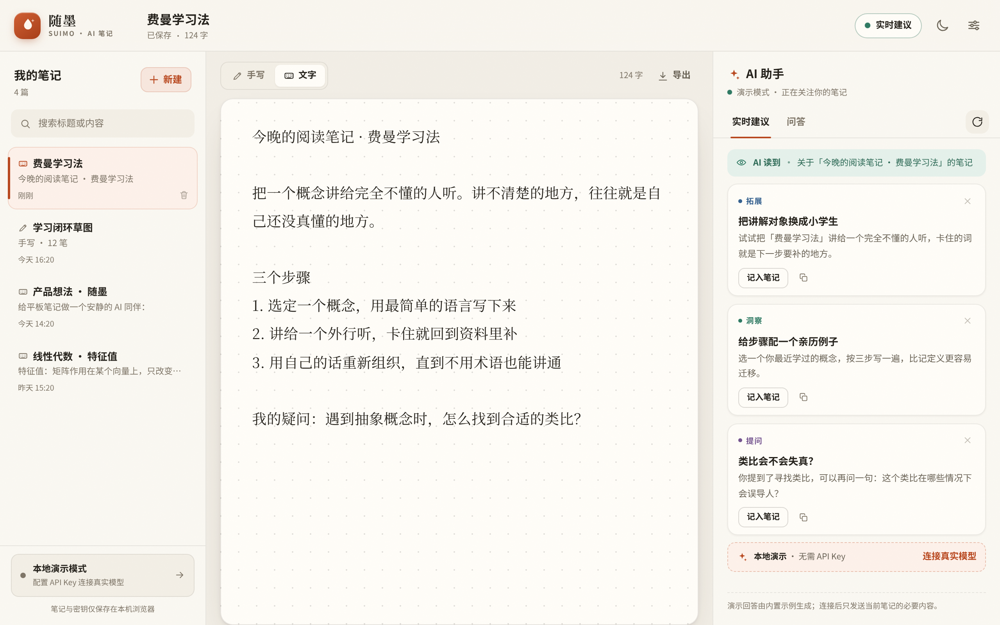
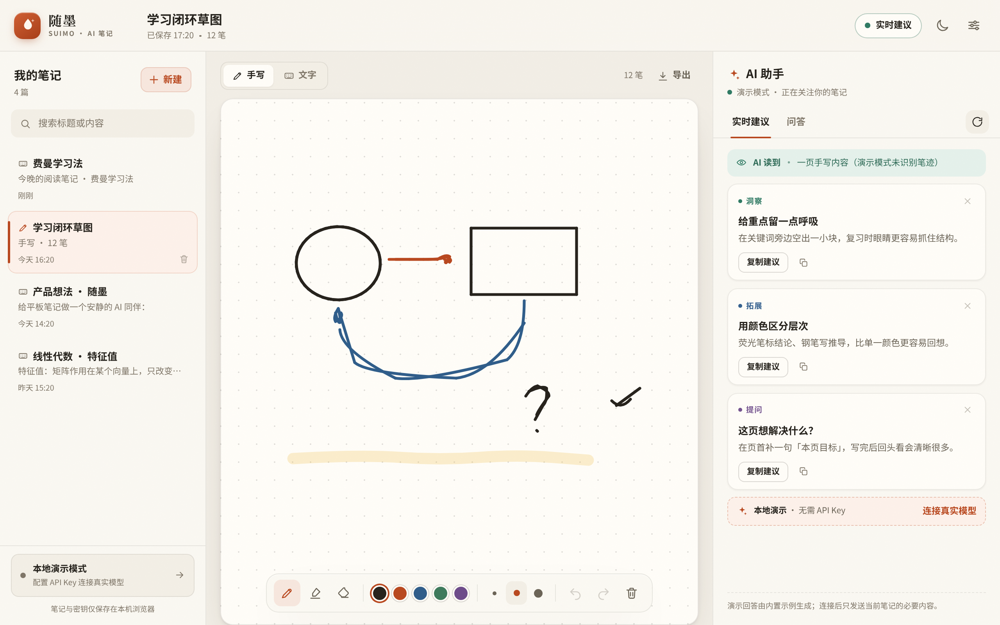
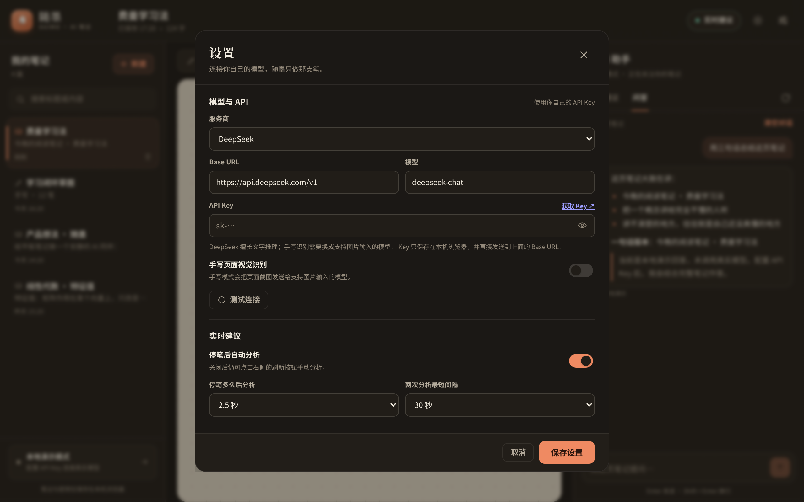
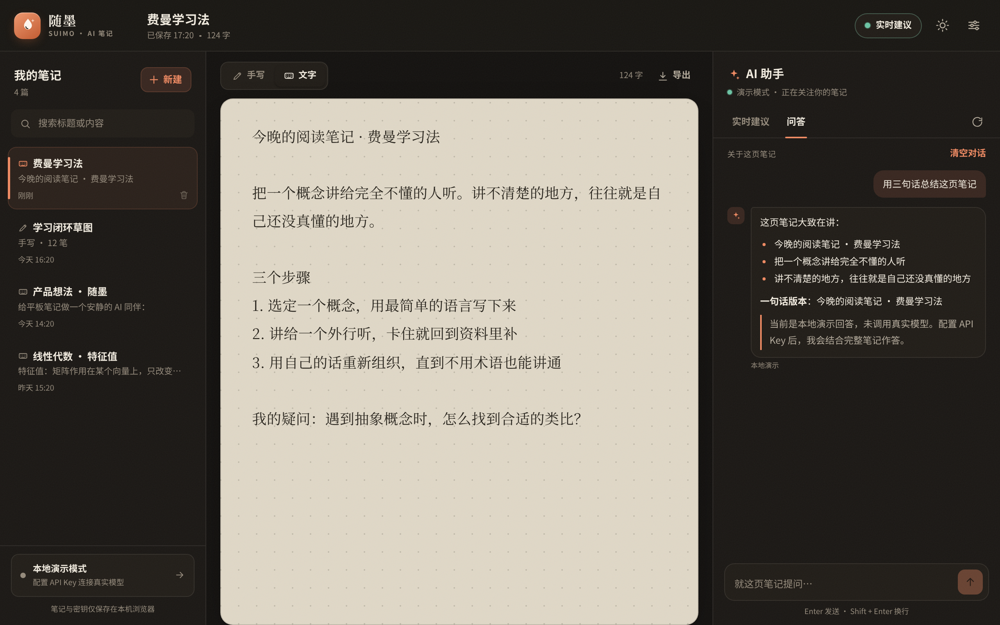
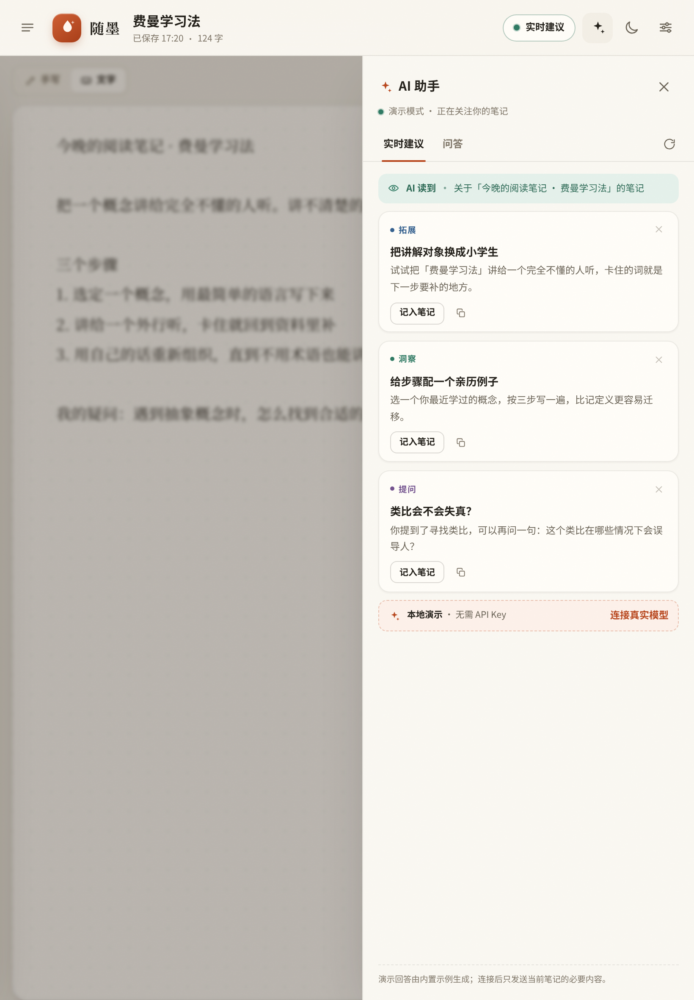

# 随墨 Suimo

> 写给 Android 平板的本地优先手写笔记 + 实时 AI 助手。边写边想，AI 在旁。

随墨是一个可以直接在浏览器里运行的平板笔记应用：用触控笔书写，停笔片刻后右侧会给出实时建议；也可以切到文字笔记，就当前这一页随时向 AI 提问。项目没有后端、没有构建步骤，填入自己的 API Key 即可连接任意 OpenAI 兼容服务。



## 功能

- **手写画布**：Pointer Events + 压感笔迹，双画布增量渲染；钢笔 / 荧光笔 / 橡皮 / 撤销重做；点阵、横线、空白三种纸张；自动适配 Retina 屏与横竖屏。
- **文字笔记**：衬线正文、自动标题、实时字数统计，适合阅读摘录和长文整理。
- **实时建议**：停笔后自动阅读当前页，给出 1–3 条简短建议（洞察 / 检查 / 拓展 / 启发提问）。建议可记入文字笔记、复制或忽略；分析频率与最短间隔可调。
- **就这页提问**：结合当前笔记的流式 Markdown 回答，支持总结、出题、找盲点等快捷提问；每篇笔记保留自己的对话。
- **手写识别**：手写模式会把页面截图发送给支持图片输入的视觉模型，让 AI 真正“看懂”笔迹；文字模式则只发送文字。
- **自带 Key，本地优先**：OpenAI / DeepSeek / Moonshot Kimi / 通义千问 / 任意 OpenAI 兼容端点。笔记、对话和 API Key 都只保存在本机 `localStorage`，请求由浏览器直连你填写的地址。
- **开箱即用的演示模式**：没有 API Key 也能完整体验界面与交互，回答由内置示例生成并明确标注。
- **为平板优化**：横屏三栏、竖屏抽屉；触控友好的按钮尺寸；深色主题下保留暖色纸张，减少夜间屏幕刺激；提供应用 manifest。
- **数据可带走**：单页导出 Markdown / PNG，全部笔记导出 JSON（不含 Key）。



## 快速开始

要求：Node.js 20+（或任意静态文件服务器）。项目零运行时依赖。

```bash
cd pad-notes-ai
npm start
```

打开终端输出的地址即可，默认是 <http://localhost:4173>。

在 Android 平板上使用：

1. 确保平板与电脑在同一个 Wi-Fi；
2. 打开启动日志里的局域网地址，例如 `http://192.168.1.23:4173`；
3. 在 Chrome 菜单中选择「添加到主屏幕」，就能从平板桌面随手打开。

不想用 Node 也可以：

```bash
cd pad-notes-ai
python3 -m http.server 4173
```

> 请通过 HTTP 服务打开，而不是直接双击 `index.html`。`file://` 下的剪贴板和部分浏览器能力会受限。

## 配置 AI

1. 点击右上角 **设置**（或左下角的「本地演示模式」卡片）。
2. 选择服务商，填入自己的 **API Key**。Key 需要到对应服务商控制台获取，例如：
   - [OpenAI API Keys](https://platform.openai.com/api-keys)
   - [DeepSeek API Keys](https://platform.deepseek.com/api_keys)
   - [Moonshot / Kimi API Keys](https://platform.moonshot.cn/console/api-keys)
   - [阿里云百炼（通义千问）](https://bailian.console.aliyun.com/)
3. 点 **测试连接**，成功后保存。



默认模型：

| 服务商 | 默认模型 | 支持图片输入 |
| --- | --- | --- |
| OpenAI | `gpt-4o-mini` | 是 |
| DeepSeek | `deepseek-chat` | 否 |
| Moonshot | `moonshot-v1-8k-vision-preview` | 是 |
| 通义千问 | `qwen-vl-max` | 是 |
| 自定义 | 手动填写 | 取决于模型 |

**手写模式需要视觉模型。** 如果使用 DeepSeek 等纯文本模型，请把手写页切换到「文字」模式，或换用支持图片输入的模型。否则设置中的「手写页面视觉识别」会提示不可用。

**关于 CORS**：请求直接从浏览器发往 Base URL，服务商必须允许浏览器跨域访问。OpenAI 兼容服务大多支持；若测试连接提示无法连接，请检查网络、Base URL，以及该服务是否允许 CORS。本项目的静态服务器不代理任何请求。

**Key 的安全**：API Key 以明文保存在本机浏览器的 `localStorage` 中，任何能打开这台设备开发者工具的人都可以看到。请使用单独、可随时吊销的 Key，不要在共享平板上保存重要 Key；离开设备前可在「设置 → 数据 → 清除全部数据」。

## 使用技巧

- **压感与手掌抑制**：用触控笔书写时，笔迹会随压力变化；笔尖附近 1.5 秒内的触摸会被忽略，手可以自然地搭在屏幕上。停笔后手指仍可继续书写，鼠标也完全可用。
- **快捷键**：`P` 钢笔、`H` 荧光笔、`E` 橡皮、`Ctrl/Cmd+Z` 撤销、`Ctrl/Cmd+Shift+Z` 重做、`Ctrl/Cmd+Enter` 立即分析、`Ctrl/Cmd+S` 保存。文字输入框内不会触发工具快捷键。
- **实时节奏**：默认停笔 2.5 秒后分析，两次自动分析至少间隔 30 秒，都可以在设置里调整。右上角「实时建议」快速开关。
- **采纳建议**：文字笔记里点「记入笔记」会把建议追加到正文末尾；手写笔记里则是复制建议，方便自己整理。
- **导出**：右上角导出按钮会按当前模式导出 Markdown 或 PNG。



平板竖屏时，AI 助手会收进右侧抽屉，笔记仍然占满屏幕。



## 数据与隐私

- 没有账号、没有服务端数据库、没有埋点。
- 笔记、对话、设置与 API Key 全部存放在当前浏览器 `localStorage`（键名 `suimo.notes.v1` / `suimo.settings.v1`）。
- 只有在生成建议或回答问题时，才会把**当前这一页**的必要内容（文字，或手写页面截图）发送给你配置的 AI 服务商。
- 导出的 JSON 不包含 API Key。
- 清除浏览器站点数据会永久删除笔记；建议定期在设置里导出备份。
- 数据只在这台设备上，不跨设备同步。

## 项目结构

```text
pad-notes-ai/
├── index.html              # 应用骨架与图标 sprite
├── css/app.css             # 设计令牌、布局、组件与响应式
├── js/
│   ├── main.js             # 应用状态、渲染、交互与设置
│   ├── ink.js              # 手写引擎（压感、橡皮、撤销、导出）
│   ├── ai.js               # OpenAI 兼容客户端、提示词、演示模式
│   ├── markdown.js         # 安全的轻量 Markdown 渲染
│   ├── store.js            # localStorage 持久化与数据校验
│   └── util.js             # 小工具函数
├── assets/                 # 图标
├── server.mjs              # 零依赖静态服务器
├── scripts/check.mjs       # 语法与资源引用检查
├── tests/                  # node:test 单元测试
└── manifest.webmanifest    # 平板「添加到主屏幕」
```

前端设计说明：

- 一套暖纸 + 朱砂的令牌体系，浅色/深色主题共享组件；深色下纸张保持低亮度暖色，避免手写墨迹在深色背景上“消失”。
- 横屏 `三栏（笔记 / 编辑 / AI）`，中屏 AI 变右侧抽屉，窄屏笔记列表也变成抽屉；抽屉共用遮罩与 Esc 关闭。
- 手写用“已提交画布 + 实时画布”双缓冲，只在提交时落历史；`ResizeObserver` 与 DPR 上限保证平板高刷与高分屏下的清晰度。
- 自动保存、笔记列表刷新、AI 请求都有防抖/冷却；流式回答按动画帧节流渲染，并只在用户接近底部时自动滚动。
- 所有模型输出先转义再渲染 Markdown；只允许 `http(s)` 链接，禁止原始 HTML。

## 测试

```bash
cd pad-notes-ai
npm test
```

包含：

- 所有 JS 模块的语法检查与 `index.html` / manifest 本地资源引用检查；
- Markdown 渲染的安全与格式测试；
- AI 提示词组装、JSON 解析、建议归一化、配置检测与演示回答测试；
- 笔记数据校验、localStorage 往返、设置合并等存储测试。

仓库中的 GitHub Actions 会在 `pad-notes-ai/**` 变更时运行同样的检查。

## 已知限制

- **浏览器不能监视其它 App。** Android 上的浏览器没有权限读取另一个笔记软件的屏幕或笔迹。因此随墨把“笔记软件”做进了应用本身：AI 监视的是随墨当前这一页的书写。如果要监视外部 App，需要原生 Android 的 MediaProjection / 无障碍或悬浮窗能力，这超出了纯前端项目的范围。
- 手写理解依赖视觉模型；演示模式不会识别真实笔迹，只会给出通用的整理建议。
- “实时”是停笔后的批处理，不是逐笔请求。这样能控制延迟和 API 费用，也更符合一口气写一段再回看的节奏。
- 受浏览器 `localStorage` 容量限制（通常约 5 MB），大量超长手写页可能保存失败；应用会提示。
- 不提供多人协作、云同步与跨设备恢复。
- 仅支持现代浏览器（Chrome / Edge / Android Chrome 等，需支持 ES Modules、Pointer Events、`dialog`、`ResizeObserver`）。

## License

本目录为演示项目；如要复用其中的代码，请遵循仓库所有者的许可安排。
