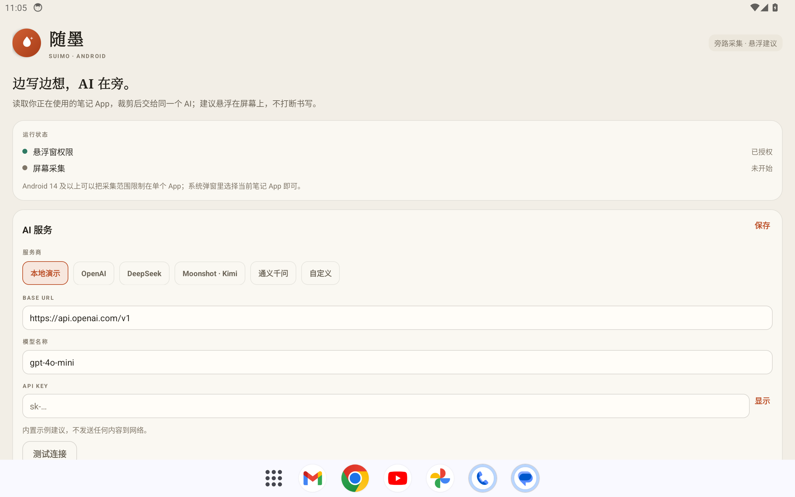
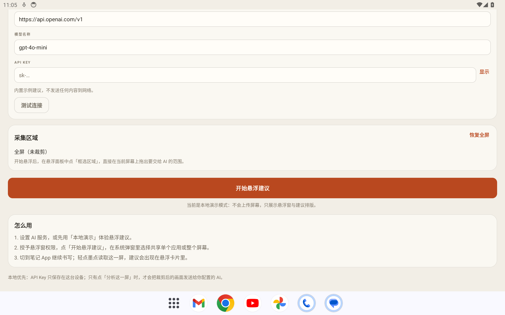
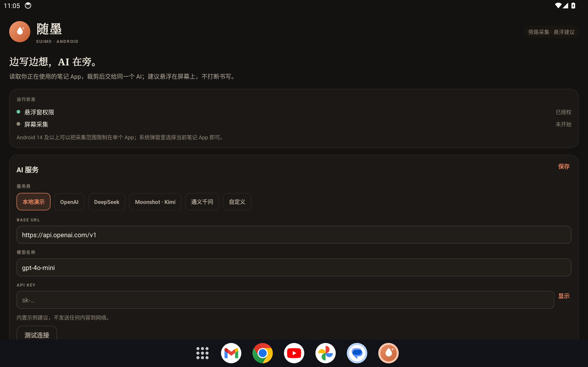
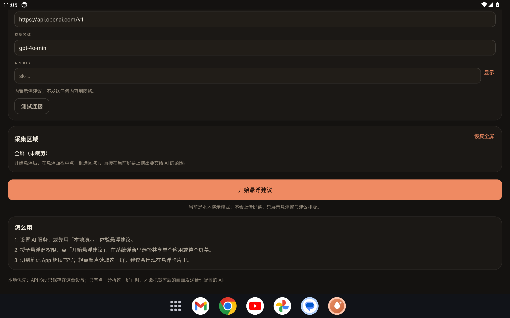
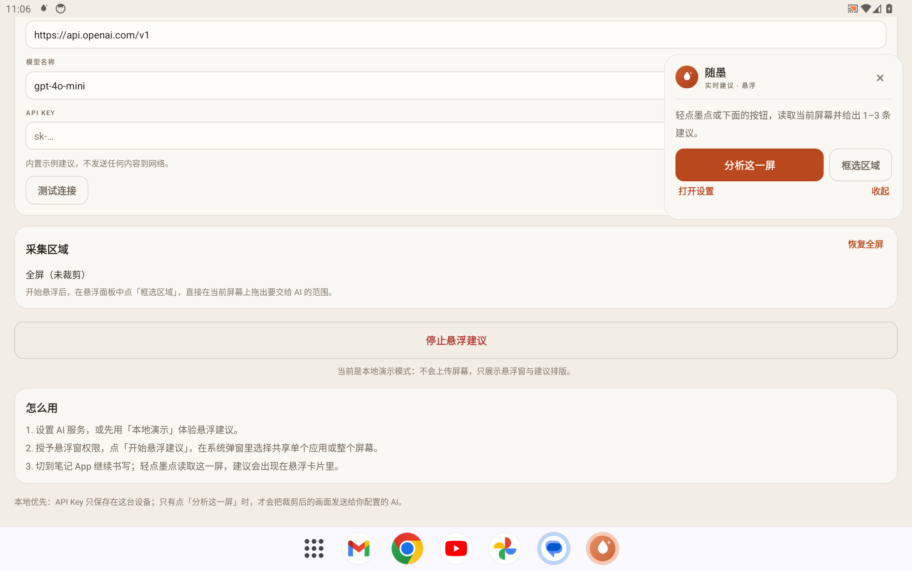
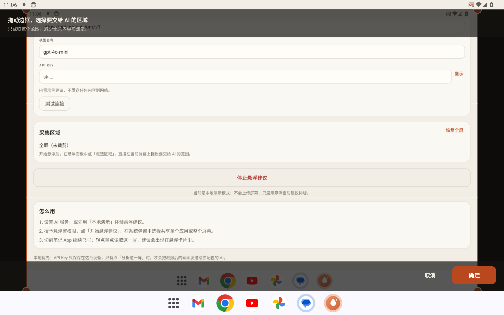
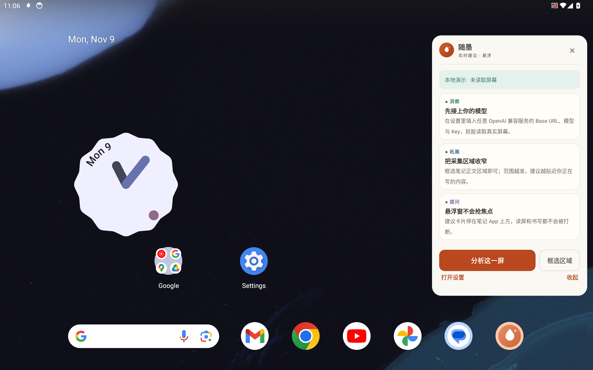

# 随墨 · Android 悬浮建议

> 写给 Android 平板的随墨旁路助手：用 MediaProjection 读取你正在用的笔记 App，裁剪后交给同一个 AI，建议以悬浮窗出现在笔记上方，不切换应用。

这个工程把 [pad-notes-ai](../pad-notes-ai)（随墨网页版）的视觉语言、服务商预设和建议提示词带到原生 Android：

- **悬浮建议**：`TYPE_APPLICATION_OVERLAY` 墨点与建议卡片浮在任意 App 上方，非焦点窗口，不打断书写。
- **旁路采集**：`MediaProjection` + `VirtualDisplay` + `ImageReader` 持续镜像当前屏幕；分析前临时移除悬浮窗，避免把自己截进去。
- **单 App 共享**：Android 14+ 走 `MediaProjectionConfig.createConfigForUserChoice()`，在系统弹窗里可以只共享当前笔记 App，减少无关内容。
- **可调裁剪**：悬浮面板里点「框选区域」，在冻结的画面上拖出要交给 AI 的范围；只上传这个范围。
- **同一个 AI**：OpenAI / DeepSeek / Moonshot Kimi / 通义千问 / 自定义 OpenAI 兼容端点，提示词与 JSON 契约直接沿用 `pad-notes-ai/js/ai.js`。
- **避免设置页误报**：提示词会忽略随墨自己的设置字段；如果模型仍建议“补全 https://”而保存的 Base URL 已是完整绝对 URL，结果过滤会丢弃这类误报，判断只使用保存后的值。
- **本地优先**：API Key 只存在本机 `SharedPreferences`；没有账号、没有服务端、没有埋点；只有点「分析这一屏」时才发送裁剪后的截图。
- **演示模式有节流**：本地演示每 8 秒最多更新一次建议，并轮换 3 组 pattern，不会连续推送同一组；它不使用「第 N 次建议」这类无限累计计数。

## 与网页版的关系

设计 token（暖纸张、墨色文字、陶土红强调色、圆角卡片、四种建议类型）与建议提示词来自 `pad-notes-ai`：

- 设计基线：`pad-notes-ai/css/app.css`
- 提示词与 JSON 契约：`pad-notes-ai/js/ai.js` 的 `SUGGESTION_SYSTEM` / `normalizeSuggestions`
- 服务商预设：`pad-notes-ai/js/ai.js` 的 `PROVIDERS`
- 来源分支：`agent/pad-notes-ai-assistant-366d0017e47f`，提交 `4a4eea2`

Android 端是原生 View 实现，不加载 WebView：截图、悬浮窗、裁剪和前台服务都需要原生能力。网页版仍负责“在随墨里写”，Android 端负责“在别的笔记 App 上给建议”。

## 构建

要求：

- JDK 17
- Android SDK Platform 34、Build-Tools 34.0.0
- 设备/模拟器 Android 8.0（API 26）及以上；Android 14 起支持单 App 共享

```bash
cd pad-notes-android
./gradlew :app:assembleDebug
# 产物：app/build/outputs/apk/debug/app-debug.apk
```

单元测试与静态检查：

```bash
./gradlew :app:testDebugUnitTest :app:lintDebug
```

## 使用

1. 安装并打开随墨，先选一个 AI 服务；没有 Key 时保留默认的「本地演示」也能体验完整悬浮窗。
2. 点「开始悬浮建议」，按系统提示授予：
   - 悬浮窗权限（显示在其他应用上层）
   - 屏幕共享（Android 14 可选择共享单个 App）
   - 通知权限（前台采集提示）
3. 切到任意笔记 App 继续写。轻点屏幕边缘的墨点读取这一屏；长按墨点打开面板；面板里的「框选区域」可以调整交给 AI 的范围。
4. 建议以 1–3 张卡片出现，类型分别是洞察 / 检查 / 拓展 / 提问。点「收起」回到墨点。

> 分析完成后会自动读取下一帧；当前版本不会按固定间隔自动分析，避免在书写过程中反复上传屏幕。需要新建议时轻点墨点即可。

## 隐私与权限

- **屏幕采集**只在本次前台服务会话内有效；Android 通知栏和系统状态栏会持续显示采集提示，随时可以停止。
- **截图不落盘**：内存中的镜像帧只用于预览、裁剪和本次 AI 请求；应用不会保存 PNG/JPEG 历史。
- **API Key** 以明文存放在应用私有 `SharedPreferences`（与网页版 localStorage 的取舍相同）。共享平板请使用可随时吊销的 Key，或离开前停止服务并清除应用数据。
- 默认允许明文 HTTP，便于连接局域网里的自建兼容服务；如果你使用公网服务，请确认 Base URL 是 HTTPS，避免 Key 明文传输。
- 受 DRM/安全窗口保护的画面在 MediaProjection 中会显示为黑屏，这是系统限制。

## 已知限制

- 悬浮面板是按钮式非焦点窗口，不支持在悬浮窗内输入文字。
- 屏幕旋转时会重建 VirtualDisplay；个别设备在旋转瞬间可能重试一次采集。
- 单 App 共享依赖 Android 14+，旧系统只能共享整个屏幕。
- 没有自动定时分析、历史建议和云同步；这些不在本次范围内。
- 当前只提交了界面与逻辑源码；APK 由 CI 构建，未在仓库内分发。

## 项目结构

```text
pad-notes-android/
├── app/src/main/java/com/suimo/assistant/
│   ├── MainActivity.kt              # 设置、权限、开始/停止
│   ├── AssistantService.kt          # 前台服务、MediaProjection、分析流程
│   ├── ai/                          # 提示词、OpenAI 兼容客户端、JSON 解析
│   ├── data/                        # 设置、服务商预设、裁剪区域
│   ├── overlay/                     # 墨点 / 建议卡片 / 框选视图
│   └── util/ImageTools.kt           # 帧转换、裁剪、缩放、JPEG
├── app/src/main/res/                # 随墨设计 token 与布局
├── app/src/test/                    # 提示词、解析、裁剪映射的 JVM 单测
└── scripts/capture-screens.sh       # CI 模拟器截图（真实运行画面）
```

## 验证

- `./gradlew :app:testDebugUnitTest`：26 个 JVM 单测，覆盖提示词契约、建议 JSON 容错、服务商端点、裁剪坐标映射、设置页误报过滤，以及演示建议的 8 秒节流 / pattern 轮换。
- `./gradlew :app:lintDebug :app:assembleDebug`：Android Lint 与 Debug APK 构建。
- GitHub Actions 的 `pad-notes-android` 工作流在 API 34 模拟器上安装 APK、授予悬浮窗权限、启动屏幕共享，并截取设置页、悬浮面板、建议卡片和框选界面。

## 截图

下面这些图片由 GitHub Actions 在 API 34 平板模拟器上安装并运行 APK 后直接截取（`adb exec-out screencap`），不是设计稿；生成与回写方式见 `scripts/capture-screens.sh` 和 `.github/workflows/pad-notes-android.yml`。

| 浅色 · 设置 | 浅色 · AI 配置 |
| --- | --- |
|  |  |

| 深色 · 设置 | 深色 · AI 配置 |
| --- | --- |
|  |  |

| 悬浮面板 | 框选区域 | 悬浮建议 |
| --- | --- | --- |
|  |  |  |

截图背景里的启动器时钟是模拟器自带的桌面组件；应用本身不包含它。最终截图文件随 PR 一起提交，代码检查与截图生成由同一次 CI 工作流完成。

> 截图由 CI 在 `android-screenshots` 标签触发时生成并回写到本分支。
